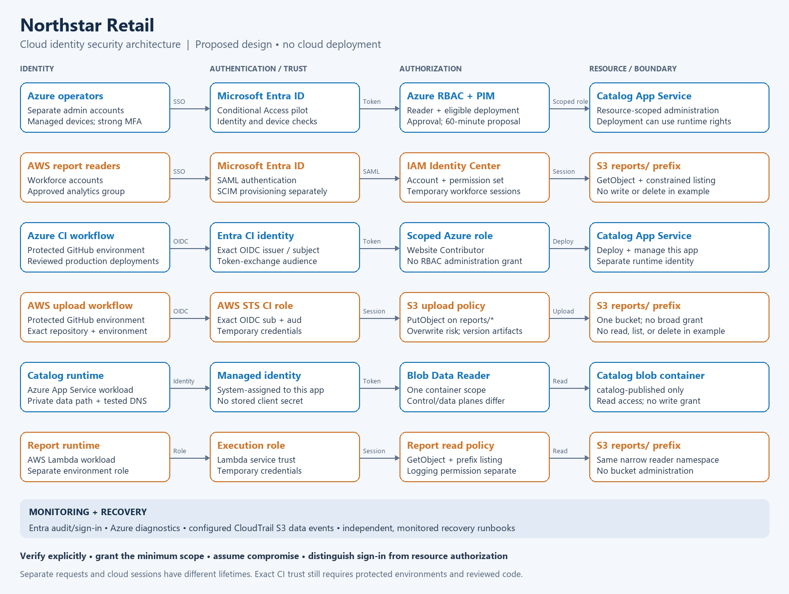

# Cloud Identity Security Architecture

Project 6: a design-only, AI-assisted multi-cloud identity project for **Northstar Retail**, a fictional company. No Azure, Entra, AWS, or GitHub security configuration was deployed or changed for this project. Examples contain deliberately fictional identifiers and require customization and live validation before use.

## Deliverables

- [Security design document](security-design.md): identity flows, authorization, threats, lifecycle, recovery, and deployment decisions.
- [Access matrix](access-matrix.md): who receives which permissions, at which scope, and why.
- [Architecture diagram](diagrams/zero-trust-architecture.svg): visual view of human and workload identity flows.
- [Mermaid source](diagrams/zero-trust-architecture.mmd): editable diagram source.
- [Policy examples](policies/README.md): Azure federation and narrowly scoped AWS trust and permission examples.
- [Validation plan](validation/validation-plan.md): expected allow/deny behavior and evidence required in a future sandbox.

## Scenario

Northstar has 120 employees and separate development and production environments. Its Azure catalog API reads published product information from one private blob container. An AWS Lambda reporting function reads generated reports from one S3 prefix. A GitHub pipeline uploads report artifacts to that same prefix. The content is fictional business data; customer identity, payment processing, and regulated records are outside this design.

The design covers Entra and Azure RBAC, AWS IAM roles and policies, workload identities, least privilege, and a Zero Trust architecture. It deliberately separates authentication from authorization, human identities from workloads, control-plane permissions from data permissions, and proposed controls from validated evidence.

## Status

Architecture and policy examples are prepared. Local validation checks syntax and specified policy boundaries only. Cloud deployment, federation, licensing, session behavior, policy evaluation, and monitoring remain untested until a dedicated sandbox is available.

**Local result:** 28 offline checks passed. See [saved results](validation/offline-results.txt). The diagram was visually reviewed for readability. This is architecture and example-policy evidence, not proof of deployed security controls.

## Reproduce the local checks

Use Python 3: `python validation/check_examples.py`. It reads only project files, makes no network requests, and creates no cloud resources. See [validation plan](validation/validation-plan.md) for the limits of these checks.

